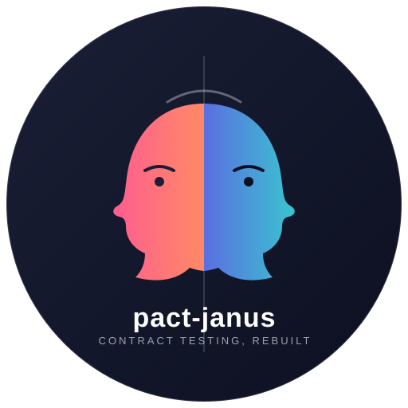

# Pact Janus
> The rebuild of the Pact framework from the ground up

<table>
<tr>
<td width="140">
  
</td>
<td>

A ground-up redesign and rebuild of the Pact contract testing framework based on the [RFC Pact MkII](https://github.com/pact-foundation/roadmap/pull/146).

Janus is the Roman god of doorways, transitions, and duality (two faces looking in opposite directions).

Pact is a testing framework with duality (consumer and provider looking in opposite directions).

</td>
</tr>
</table>

**Status:** early. This repository is where the Pact MkII engine, its specifications and its first two
SDKs are being built, to the [staged implementation plan](Documentation/staged-implementation-plan.md).
The work is in stage 0a, the foundations. There is a first [release](https://github.com/rholshausen/pact-janus/releases),
of the engine and the CLI as binaries, so that the SDKs here can pin one; it is not production software.
It is not "Pact 6" either: "Janus" is a codename, and the name is the Pact community's to choose.

It began as a prototype, built to test the RFC's bets against real code. That prototype is complete,
and the real build hardens it in place rather than starting again
([ADR 0027](Documentation/decisions/0027-build-in-the-prototype-repository-and-graduate-sdks-into-their-existing-repositories.md)).
What the prototype found is kept as [its record](Documentation/prototype/README.md): **if you are new
here, start with the [community report](Documentation/prototype/prototype-report.md).**


## What it is

The RFC keeps Pact's core idea: consumer-driven contracts, captured by the consumer and replayed
against the provider. It rebuilds everything underneath. Janus is that design:

- **One engine, thin SDKs.** A single Rust engine behind a versioned, document-based protocol.
  TypeScript and JVM SDKs a few hundred lines each, both held to one shared conformance suite.
- **Declarative interactions, compiled plans.** An interaction compiles to a matching plan that
  `janus explain` prints. Existing v1–v4 pacts compile to plans too, and verify unchanged.
- **Everything is a component.** HTTP, JSON and OAuth2 are components behind the same interfaces a
  third-party plugin uses. A `text/csv` plugin written from the docs alone runs as WASM, distributed
  as an OCI artifact.
- **Shapes with honest optionality.** `optional`, `anyOf`, `oneOf`, `eachLike`. Each declared variation
  is a variant the consumer test must pass. Providers can publish their own shapes, and `janus check`
  finds what they may send that a consumer never tested.
- **Scriptable lifecycle.** Hooks for auth, provider state and more, declared in configuration, with
  JavaScript as the escape hatch.

All of that runs today, as the prototype left it. What held, what changed and what is still open is in
the [community report](Documentation/prototype/prototype-report.md), and in more detail in
[RFC feedback](Documentation/prototype/rfc-feedback.md).

## Where the build is going

The [staged implementation plan](Documentation/staged-implementation-plan.md) is the live plan. Every
item in it has an id (`S0.1`, `S1.4`, …), a size, and an exit that CI, a corpus or a measurement can
check. Its stages, in order:

| Stage | What it delivers |
|---|---|
| **0** Foundations | Plan grammar v1, CI on Linux, macOS and Windows, a release pipeline for signed engine binaries, the benchmark trend, and a codename that can be renamed mechanically |
| **1** A drop-in provider verifier | Providers switch verifiers at no cost: every existing v1–v4 pact verifies exactly as it does today, measured by a differential harness against today's verifier |
| **2** The consumer engine, and the JS and JVM SDKs | The SDKs ship as the next major version of pact-js and pact-jvm, with a compatibility facade for today's DSL, and graduate into those repositories |
| **3** Shapes and variants in the DSLs | The RFC's answer to optional fields, delivered to users |
| **4** Provider shapes and the subsumption check | Catching what a provider may send that no consumer tested |
| **5** Plugins as the core design | The component model, opened to the ecosystem |
| **6** Breadth | More SDKs, each written from the SDK specification and held to the conformance suite |

Providers come first because a provider that can switch verifiers at no cost lets consumers adopt the
new format without breaking anyone. The plan also says what is deliberately left open, what would
reopen it, and which questions are the community's rather than this repository's.

## Try it

You need a recent stable Rust toolchain (see `rust-toolchain.toml`), libclang (the engine embeds
QuickJS), and Node 22.6 or later with npm.

```sh
demo/run.sh                  # the RFC's whole loop, step by step (press Enter between steps)
```

Or drive the pieces yourself:

```sh
cargo build                                                   # engine, CLI (janus, janus-engine), sample provider
target/debug/janus explain samples/order-service/pacts/web-app-order-service.json   # the matching plan
target/debug/janus upgrade samples/order-service/pacts/web-app-order-service.json   # v3 pact -> contract, and what changed
target/debug/janus check samples/order-service/pacts/web-app-order-service.json \
  --provider-shape samples/order-service/shapes/                                   # what the consumer never tested
```

`janus verify` needs a running provider. The [demo](demo/README.md) and the
[sample provider's README](samples/order-service/README.md) show how.

## Building and testing

```sh
cargo test                                    # Rust workspace: engine, CLI, tools, golden corpora
(cd sdks/typescript && npm ci && npm test)    # TypeScript SDK, against a real janus-engine
(cd sdks/jvm && ./gradlew build)              # JVM SDK (JDK 17)
cargo run -p pact_janus_conformance -- check target/conformance/*.json   # both SDKs conformant
cargo run -p pact_janus_doc_links             # every relative link in the documentation resolves
```

CI runs all of that on Linux, macOS and Windows, and also clippy, rustfmt, the `wasm32-wasip2` build,
schema-compatibility checks, the SDK thinness audit and `demo/run.sh --ci`. [CONTRIBUTING.md](CONTRIBUTING.md) has the practicalities,
including the change file a pull request needs when it changes what a release ships, and how a release is made.

## What is where

| Path | |
|---|---|
| [`engine/`](engine) | The kernel (plan compiler and interpreter, shapes, variants, subsumption, the protocol), the built-in HTTP, JSON and OAuth2 components, the hooks host, the WASM component loader, and the engine itself as a WASM component for offline use |
| [`cli/`](cli) | `janus` (`verify`, `check`, `explain`, `upgrade`, `component push/pull`) and `janus-engine`, the subprocess every SDK embeds |
| [`sdks/`](sdks/README.md) | The TypeScript and JVM SDKs, with generated protocol bindings. Incubated here; they graduate into pact-js and pact-jvm (ADR 0027) |
| [`conformance/`](conformance) | The shared corpus of cases both SDKs must pass |
| [`corpora/`](corpora/README.md) | Golden matching corpora: input, expected plan, expected result |
| [`samples/order-service`](samples/order-service/README.md) | The sample provider, with deliberate variance, auth and v3 provider states |
| [`demo/`](demo/README.md) | The RFC loop as a runnable, recorded walkthrough |
| [`third-party/janus-csv`](third-party) | A plugin written as a third party would, from the published specs only |
| [`benchmarks/`](benchmarks) | The `pact_ffi` baseline and the Janus performance harness, whose numbers CI adds to a [trend chart](https://rholshausen.github.io/pact-janus/bench/) on every merge |
| [`tools/`](tools) | The checkers CI runs: schema compatibility, the corpora, conformance, SDK thinness, binding generation, documentation links |
| [`spikes/`](spikes/README.md) | The findings of the prototype's time-boxed experiments. Findings only: their code is gone |
| [`Documentation/`](Documentation) | The staged plan, the specifications, the decisions (ADRs), the charter, and [the prototype's record](Documentation/prototype/README.md) |

## Key documents

The real build:

- [Staged implementation plan](Documentation/staged-implementation-plan.md): what carries over from
  the prototype, the build order, the gates that could change it, and the questions for the community.
- [Specifications](Documentation/specs): the engine protocol, shape language, variant semantics, plan
  grammar, contract file, component interfaces, lifecycle hooks, subsumption check and SDK
  specification. Normative for the code.
- [Decision records](Documentation/decisions/README.md): every contested choice, and what would reopen it.

[The prototype's record](Documentation/prototype/README.md):

- [Community report](Documentation/prototype/prototype-report.md): the short version, for everyone.
- [RFC feedback](Documentation/prototype/rfc-feedback.md): every question the RFC left open, answered
  with evidence.
- [Phase 9 findings](Documentation/prototype/phase-9-findings.md): what using the prototype turned up.
  The staged plan cites them by number.
- [Charter](Documentation/charter.md) and [project plan](Documentation/prototype/project-plan.md): what
  the prototype set out to prove, and how.

## Get involved

The design discussion happens on the [RFC pull request](https://github.com/pact-foundation/roadmap/pull/146).

## License

[Apache 2.0](LICENSE).
